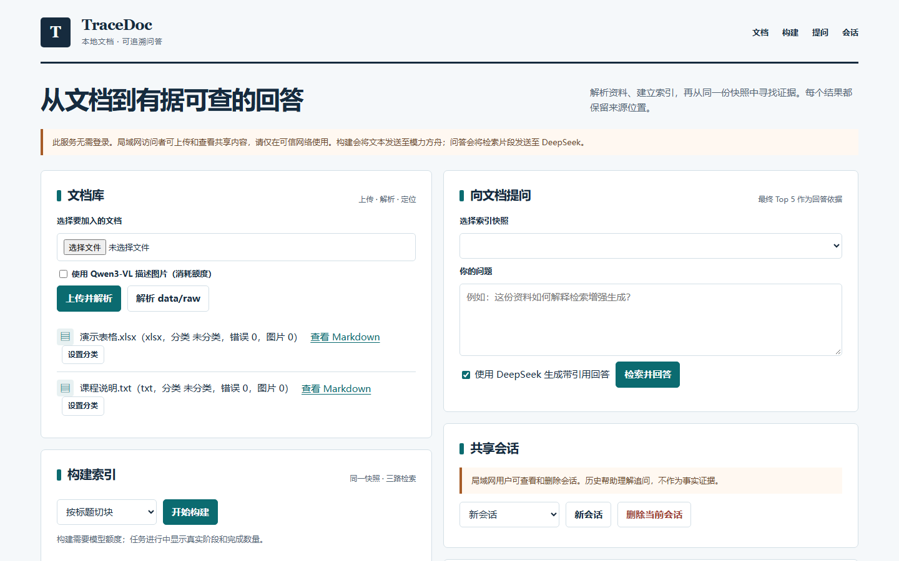
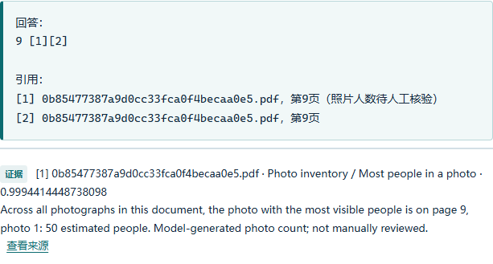

# TraceDoc RAG 项目介绍

> 文档状态：提交版候选，已加入实测图示与正式带引用问答截图
> 评测更新日期：2026-10-30
> 评测快照：原始 `20261026T093858Z-8329980e`；新表格上下文 `20261029T155325Z-5c7d8346`
> 注意：原始标签、人工复核补充标签和新快照成绩分别呈现。

## 1. 项目概述

TraceDoc RAG 是一个面向本地多模态文档的可追溯问答系统。系统将 PDF、DOCX、PPTX、XLSX、TXT 和图片转换为带来源定位的 Markdown，建立共享 Chunk 快照和三路检索索引，再通过 RRF 融合、Qwen3 精排与 DeepSeek 生成带引用的回答。

项目重点不是只生成答案，而是让每条答案能够回到同一个已保存快照中的 Top 5 证据，并保留文档、页码或标题路径。资料不足、证据冲突或图片描述未经人工复核时，系统会明确提示限制。

## 2. 主要目标

- 支持常见文档和图片的批量解析，单文件失败不终止整批任务。
- 保留 PDF 页码、PPTX 幻灯片号、DOCX 标题路径等来源信息。
- 让 BM25、Dense 和 bge-m3 三路索引共享同一份 Chunk 快照。
- 使用排名融合而不是直接相加不同检索器的原始分数。
- 只把最终 Top 5 作为 DeepSeek 回答的证据，并输出可核查引用。
- 同时提供 CLI 和可信局域网 Web 界面。
- 通过 Recall@5、MRR、候选覆盖和逐题排序误差分析真实呈现质量。

## 3. 系统架构

```text
PDF / DOCX / PPTX / XLSX / TXT / 图片
                 |
                 v
         文档解析与资产提取
      Markdown + manifest + images
                 |
                 v
       固定窗口 / 结构化 Chunk
                 |
                 v
          同一个 Chunk Snapshot
          /          |          \
         /           |           \
 BM25 + jieba   Qwen3 Dense    bge-m3
         \           |           /
          \          |          /
              RRF (k=60)
              Top 50 候选
                   |
                   v
      MoArk Qwen3-Reranker-8B
               最终 Top 5
                   |
                   v
       DeepSeek Chat 带引用回答
                   |
                   v
        CLI 输出 / 局域网 Web
```

角色边界如下：

| 能力 | 模型或组件 | 用途 |
|---|---|---|
| Dense Embedding | MoArk Qwen3-Embedding-8B | Build 与 Query 使用相同模型 |
| 关键词检索 | jieba + rank-bm25 | 中文分词和精确词匹配 |
| 语义补充检索 | 本地 BAAI/bge-m3 | 与 Qwen3 Dense 形成互补 |
| 精排 | MoArk Qwen3-Reranker-8B | 对 RRF 候选进行交叉编码排序 |
| 图片描述 | MoArk Qwen3-VL | 可选；描述绑定真实资产和来源页 |
| 最终回答 | DeepSeek `deepseek-chat` | 仅根据最终 Top 5 生成带引用回答 |

DeepSeek 不用于 Embedding；切换 Embedding 模型时必须重新 Build，不能修改旧快照元数据冒充新模型。

## 4. 文档解析与多模态证据

### 4.1 支持格式

- PDF：使用 PyMuPDF 逐页提取文本、嵌入图片和可选整页渲染，在 Markdown 中保留 `<!-- PAGE:n -->`。
- DOCX：按标题样式转换 Markdown，为段落生成定位标识，不伪造页码。
- PPTX：按幻灯片顺序提取标题、正文、备注和图片，保留 slide 编号。
- XLSX：只读工作表已保存的单元格值，Markdown 保留工作表与原始行号；不执行公式或伪造页码。单表上限 5000 行、100 列，超限写入错误记录。未缓存公式结果、图表与旧 `.xls` 不支持。
- TXT：检测编码，转为 Markdown，并在 manifest 中记录字符数。
- 图片：通过真实文件内容识别格式，不仅依赖扩展名；可执行本地 OCR。

每个文档产出独立目录：

```text
data/parsed/{doc_id}/
  document.md
  images/
  manifest.json
  errors.jsonl
```

### 4.2 图片证据边界

视觉模型生成的图片描述会绑定实际图片资产以及可用的页码或幻灯片号，并标注模型和 `unreviewed` 状态。视觉描述是辅助语义，不等同于经过人工确认的原文；没有实际图片资产时不能生成或引用图片结论。

## 5. Build：共享快照与三路索引

系统从 `data/parsed/` 读取第一阶段产物，不在 Build 时重新解析 `data/raw/`。

支持两种切块策略：

1. 固定窗口：400 字符，50 字符 overlap。
2. 结构化切块：优先按 Markdown 标题层级切分，超长章节再执行固定窗口切分。

每个 Chunk 分开保存机器标识 `chunk_id` 和展示名称 `display_name`，并携带 `doc_id`、文本、页码范围和 `heading_path`。每次 Build 生成唯一 `snapshot_id`；三路索引共用同一份 `chunks.jsonl`。Embedding 失败的 Chunk 会被跳过并写入错误日志，不会用全零向量污染索引。

## 6. Query：混合检索与引用问答

Query 严格加载一个完整、已保存的 Build 快照，不重新解析文档、不重新切块，也不创建另一套 Chunk。

检索流程为：

```text
用户问题
  -> BM25 Top 20
  -> Qwen3 Dense Top 20
  -> bge-m3 Top 20
  -> RRF(k=60) Top 50
  -> Qwen3 Reranker
  -> 最终 Top 5
  -> DeepSeek 回答与引用
```

RRF 公式为：

```text
score(d) = sum(1 / (60 + rank_i(d)))
```

BM25、Dense 和 bge-m3 的原始分数尺度不同，因此项目禁止直接把三路原始分数相加。

DeepSeek 收到编号化 Context，并被要求：

1. 只依据 Context 回答；
2. 关键结论使用 `[1][2]` 等编号引用；
3. 不编造引用；
4. 资料不足时明确说明。

Prompt、原始模型响应、解析出的引用编号和最终展示答案在程序中保持为不同值。API 失败时，系统仍保留并输出检索 Top 5。

## 7. CLI 与 Web 产品

### 7.1 CLI

```powershell
python app.py parse
python app.py build
python app.py query "用户问题"
python app.py test GOLD.jsonl --snapshot-id SNAPSHOT_ID
python app.py serve
```

CLI 是项目主入口；增加 Web 后仍保持 `parse`、`build`、`query` 和 `test` 可用。

### 7.2 局域网 Web

Web 界面面向可信局域网多人共享，可完成上传与解析、共享文档分类、Build 真实逐块进度、选择快照、提问、查看 Top 5 与同页图片、查看回答与引用、多轮会话以及后台任务状态。失败、部分成功或服务重启后中断的安全任务可以重试，页面可以查看结构化错误摘要。匿名统计只记录请求次数、失败、耗时和 DeepSeek 实际返回的 Token 用量；逐题好评或差评只保存关联 ID 和评分。



模型和密钥管理只允许从服务所在电脑访问。真实 API Key 不进入代码、Git、快照、报告或请求日志；Windows 环境下使用当前用户 DPAPI 保存。服务不记录问题正文、原始 Prompt、原始模型响应或 Chunk 文本到请求事件日志。

局域网模式当前无登录，因此同网段可访问者能够看到共享文档和会话。该模式不能直接暴露到互联网，也不适合存放私人资料。

## 8. 评测设计

项目使用本地 MMLongBench-Doc 三文档试点，共 18 个有证据页的问题。评测保留数据集原始 `evidence_pages` 标签，不对全部题目统一加减页码；系统引用仍使用 PDF 物理页。两种编号的对应关系需逐题核验。正式报告同时保存 BM25、Dense、bge-m3 和融合精排的 Recall@5 与 MRR，并补充 Reranker 单题诊断和人工 Gold 复核。

### 8.1 原始证据页标签的正式评测

2026-10-29 使用同一个 415 Chunk 完整快照、保留原始证据页标签的 18 题 Gold 实际运行三路检索、RRF 和 Qwen3 精排。原始 MMLongBench 文件保持只读。以下数值来自 `data/benchmarks/mmlongbench_page_corrected/evaluation_vision/20261029T105551Z-8cc7e5a6/report.json`。

| 路线 | Recall@5 | MRR |
|---|---:|---:|
| BM25 | 0.6111 | 0.6111 |
| Qwen3 Dense | 0.7222 | 0.7500 |
| bge-m3 | 0.6778 | 0.6250 |
| RRF + Qwen3 Reranker | 0.6944 | 0.6713 |

正式验收 6 项通过、1 项失败：融合 Recall@5 低于最佳单路 Dense。第 12 题贡献了全部差距；原始导入 Gold 标注的两个证据位置为 PDF 物理第 8、10 页，最终 Top 5 仅命中第 10 页。该结果仍按原标签完整保留。

### 8.2 人工复核补充结果

原 PDF 物理第 8 页没有第 12 题所问的年龄组数据；第 10 页图表显示 18–29 岁强烈不赞同为 46%、65 岁以上为 39%，差值 7.0。用户确认第 10 页及两个数值后，系统生成独立的 `reviewed_q12/gold_reviewed.jsonl`，只把该题证据位置从 `[8,10]` 调整为 `[10]`。基于正式报告保存的 Top 5 离线重算如下，不重复调用模型，也不覆盖原始成绩。

| 路线 | 复核后 Recall@5 | 复核后 MRR |
|---|---:|---:|
| BM25 | 0.6389 | 0.6111 |
| Qwen3 Dense | 0.7222 | 0.7500 |
| bge-m3 | 0.7056 | 0.6250 |
| RRF + Qwen3 Reranker | 0.7222 | 0.6713 |

原快照中，第 12 题最终 Top 5 虽有第 10 页 Chunk，却没有同时包含计算答案所需的 46% 和 39%。因此原快照的页码 Recall 改善不代表这题已具备完整回答证据。

### 8.3 长表格上下文新快照

独立完整快照 `20261029T155325Z-5c7d8346` 将同页图表开头原文附到长表格切块，三路索引均为 444/444。第 12 题最终 Top 5 的一个 Chunk 同时包含图表标题、18–29 岁的 46% 与 65 岁以上的 39%。同一快照在 18 题**原始证据页标签**上重新实测：BM25、Dense、bge-m3、融合精排的 Recall@5 分别为 0.6222、0.6944、0.6778、0.7222；MRR 分别为 0.5574、0.7500、0.6435、0.6852。原始标签报告为 `data/benchmarks/mmlongbench_page_corrected/evaluation_original_labels/20261030T024720Z-4c931a87/report.json`。仅第 12 题标签改为 `[10]` 的人工复核版结果如下：

| 路线 | 新快照 Recall@5 | 新快照 MRR |
|---|---:|---:|
| BM25 | 0.6500 | 0.5574 |
| Qwen3 Dense | 0.7222 | 0.7500 |
| bge-m3 | 0.7056 | 0.6435 |
| RRF + Qwen3 Reranker | 0.7500 | 0.6852 |

复核版结果文件为 `data/benchmarks/mmlongbench_page_corrected/evaluation_table_context/20261029T155804Z-179cd89d/report.json`。原始与复核版不能混称；图表列与数值仍需按原图人工核验。上述 Recall@5 是标注证据页检索指标，并非最终问答正确率。

### 8.3.1 全页视觉描述复测（2026-10-30）

先前视觉增强只描述 Gold 标注的证据页，存在标签选择泄漏，因此不能将其分数当作独立的正式质量结论。本次对试点三份 PDF 的全部 48 个物理页生成视觉描述，未依据题目或 Gold 选页；描述均绑定整页图片并标记为 `unreviewed`。新快照 `20261030T030940Z-b7ed7e55` 的三路索引共同收录 539 个 Chunk，构建错误为 0。原始 18 题 Gold 的实际评测报告为 `data/benchmarks/mmlongbench_page_corrected/evaluation_all_page_vision/20261030T031356Z-cc69a480/report.json`。

| 路线 | 原始标签 Recall@5 | 原始标签 MRR | 第 12 题复核版 Recall@5 |
|---|---:|---:|---:|
| BM25 | 0.6778 | 0.6852 | 0.7056 |
| Qwen3 Dense | 0.8333 | 0.7963 | 0.8333 |
| bge-m3 | 0.8167 | 0.7917 | 0.8444 |
| RRF + Qwen3 Reranker | 0.8444 | 0.8472 | 0.8444 |

复核版仅把第 12 题标签从 `[8,10]` 改为 `[10]`，采用同一次检索结果离线重算，记录见 `data/benchmarks/mmlongbench_page_corrected/reviewed_all_page_vision/gold_review_report.md`。第 3、6 题由完全未命中变为命中，最终 Top 5 的文本分别包含 `0–375` 和欧洲 `130` 的图表数值；这两页已对照原始渲染图人工核验。第 12 题最终首条 Chunk 同时包含 `46` 与 `39`，仍应以表格列标题核对后计算。第 17 题只命中 5 个标注页中的 1 页，无法由 Top 5 完成全图计数；第 18 题仍未命中。视觉描述其余页面尚未经人工核验，Recall/MRR 只表示证据位置检索，不表示答案正确率。

### 8.3.2 跨页照片计数实验（2026-10-30）

对上述 48 页的已保存整页图片再次调用 Qwen3-VL，逐张记录照片中的可见人数、是否为估计值、页码和原图资产 ID；未重新解析 PDF，也未按 Gold 选择页面。模型将第 16 页徽标误列为人数未知的照片；检查原图后仅在新产物中删除该条，并保存 `photo_inventory_manual_review.jsonl` 审计记录。只有全部页均完成、所有照片人数均已知时才生成跨页汇总 Chunk；其 `evidence_pages` 明列原始页码，不伪装成单页或连续页。人数仍是视觉模型推断，除已核查页面外均标记为未经人工核验。

最终快照 `20261030T090057Z-d5fa3f1a` 三路均索引 556/556 Chunk，错误 0。对**原始** 18 题 Gold 的报告 `data/benchmarks/mmlongbench_page_corrected/evaluation_photo_reviewed_full/20261030T090632Z-0940a301/report.json` 得到：

| 路线 | Recall@5 | MRR |
|---|---:|---:|
| BM25 | 0.7778 | 0.7685 |
| Qwen3 Dense | 0.8611 | 0.8241 |
| bge-m3 | 0.9167 | 0.8750 |
| RRF + Qwen3 Reranker | 0.9722 | 0.9028 |

第 17、18 题的最终 Top 5 首位分别为单人照片汇总（6 张，证据页 2、4、5、14、15）和人数最多照片汇总（第 9 页，约 50 人）；两题的页码 Recall@5、MRR 均为 1.0。DeepSeek 实测分别回答 6 和 `9 [1][2]`，引用指向快照中的证据页。第 12 题仅改为 `[10]` 的复核版融合精排 Recall@5 同为 0.9722，见 `data/benchmarks/mmlongbench_page_corrected/reviewed_photo_full/gold_review_report.md`。**该成绩使用跨页汇总 Chunk，评测粒度已改变，不能与只含逐页 Chunk 的 0.8444 当作相同条件下的模型提升；照片人数也不能当作已人工全部核验的事实。**


### 8.4 提交前核对

- [x] 固定评测 snapshot ID、Gold 文件及 18 题正式报告。
- [x] 保存原始标签成绩与第 12 题人工复核后的补充成绩。
- [x] 保存正式 Acceptance 报告与单题精排诊断。
- [x] 源码提交为 `8e82b05b1576f52492810a34117ecf17618d8752`；Windows 发行包以此提交构建。
- [ ] 插入脱敏的真实界面与报告截图，并复核 Word 版式。

### 8.5 最终配图清单

最终 Word 介绍材料需要补充以下真实图片或截图：

- [ ] 系统架构或端到端流程示意图。
- [ ] 文档解析后的 Markdown、图片资产和来源定位。
- [ ] Build 完成后的完整 snapshot 与三路索引状态。
- [ ] Query 最终 Top 5、来源页码或标题路径。
- [ ] DeepSeek 带编号引用的回答。
- [ ] 局域网 Web 首页、提问结果和来源查看页面。
- [ ] 本机模型配置状态页面，只显示是否配置，不显示任何密钥。
- [ ] 18 题正式评测和 Acceptance 报告。

所有截图应使用演示数据，裁去无关桌面区域，并确认不含 API Key、私人路径、个人文档、共享会话隐私或其他敏感信息。每张图需要简短图题，说明展示的功能和结果；最终插入 Word 后重新执行逐页版式检查。

## 9. 安全、隐私与可复现性

- `.env`、API Key、DPAPI 密钥文件、原始文档、会话数据库、模型缓存和大型索引不提交 Git。
- `.env.example` 只包含占位符。
- Build 与 Query 的模型信息、Chunk 校验和和快照状态保存在元数据中。
- 原始 Gold 不覆盖；人工复核生成派生文件和审计报告。
- 文档、OCR 文本和历史回答都视为数据，不视为指令。
- Query 只引用当前轮最终 Top 5；历史回答不能成为证据。

## 10. 已知限制

1. **检索质量与答案证据是两项不同检查。** 早期 18 题报告中融合精排 Recall@5 为 0.6944，低于 Dense 的 0.7222；该历史报告保留。全页视觉描述快照的原始标签融合 Recall@5 为 0.8444。加入跨页照片汇总后的新快照达到 0.9722，但 Chunk 证据粒度已改变，不能解释为相同条件下模型本身提升。第 12 题最终 Top 5 现包含 46% 和 39%；图表列值仍需按原图核对。照片人数由视觉模型估计，尤其第 9 页拥挤照片不能宣称精确为 50 人。
2. **扫描页 OCR 只提供待核验文本。** 可选的本地整页 OCR 在真实图片型页面试验中提取了 152 个字符，但标题词间距及小字仍有误识。原图、OCR 块和来源页一同保留，OCR 标记为 `unreviewed`；涉及日期、人名或数字时须回看原图，无法确认就回答资料不足。改进后的解析文本需要新建索引快照，不能改写旧快照。
3. **图表与照片视觉描述尚未逐项人工核验。** Qwen3-VL 描述绑定真实图片和页码，但图例、单位、数字、人数和图形关系可能误读，保留 `unreviewed` 标记。第 16 页徽标误识别已留人工修正记录；其他页的照片人数仍需抽查。演示中应展示原图和描述的对应关系；只有核对过的具体结论才能用于确定性回答。
4. MoArk 额度有限；无额度时展示已保存的真实 18 题报告，不伪造现场调用。
5. PPTX 已用真实 7 页文件验证 43 个图片资产和幻灯片定位；旧 `.ppt` 不支持。
6. Web 无登录，仅适合可信局域网；所有用户共享文档和会话。
7. Build 页面显示真实阶段和错误数，尚无逐块进度百分比。
8. 模型服务、网络和本地 bge-m3 权重是完整运行的外部依赖。

## 11. 3–5 分钟演示脚本

### 有模型额度

1. 用 `python app.py serve` 启动 Web，并说明默认只绑定本机。
2. 展示已解析文档、图片资产和 manifest 中的来源定位。
3. 选择一个完整 snapshot，说明三路索引共享同一 Chunk 集合。
4. 输入问题，展示三路召回、RRF、精排后的 Top 5。
5. 展示 DeepSeek 回答和 `[1][2]` 引用。
6. 打开引用来源，核对页码、标题路径或图片资产。
7. 展示原始标签的最新评测表，并说明跨页汇总 Chunk 改变了证据粒度，照片人数仍有待人工核验。

### 无模型额度

1. 启动 Web，展示文档、快照、历史任务和已保存会话。
2. 使用已有的脱敏 Query、回答和引用截图说明完整流程。
3. 打开保存的正式评测、候选分析和 Gold 复核报告。
4. 说明现场未发起 MoArk 调用是为了避免把额度错误伪装成系统失败。
5. 运行不消耗模型额度的单元测试或 `compileall` 作为现场验证。

## 12. 环境与运行

环境要求：Windows、Python 3.10+；完整 Build/Query 还需要 MoArk 额度、本地 bge-m3 权重和 DeepSeek API Key。

```powershell
cd D:\RAG
python -m venv .venv
.venv\Scripts\Activate.ps1
pip install -r requirements.txt
Copy-Item .env.example .env
# 在 .env 中填写自己的密钥，不要提交该文件
python app.py --help
python app.py serve
```

### 12.1 正式带引用问答截图

使用已保存的完整快照 `20261030T090057Z-d5fa3f1a` 对 MMLongBench-Doc 第 18 题执行真实 Web 问答。返回最终 Top 5，DeepSeek 回答 `9 [1][2]`；两条引用均定位到同一 PDF 第 9 页。图中展示实际回答与首条检索证据，其图片人数是视觉模型估计，仍标记为未经逐图人工核验。



## 13. 提交物

- 源码：`release/TraceDocRAG-source-20261031.zip` 是当前工作目录快照，含照片清单、跨页汇总与 XLSX 解析；其 `SOURCE_STATE.txt` 标明基准 Git 提交与尚未提交的改动。GitHub `https://github.com/a4l111/tracedoc-rag` 仍为较早版本。源码 ZIP 解压后 63 项测试通过。
- 可执行入口：`release/TraceDocRAG-Windows-20261031.zip` 是同一工作目录重建的 Windows onedir Web 发行包，`TraceDocRAG.exe --help` 已通过；本机 Web 上传合成 XLSX 后后台解析完成、错误 0。完整模型问答仍需另配权重和 API Key。`start_web.bat` 是依赖 Python 环境的备用入口。
- 介绍材料：本 Word 文件为提交版候选，已加入隔离演示 Web 截图、真实评测图和正式快照带引用问答截图。
- 评测附件：脱敏后的正式报告、候选分析、人工复核报告和必要截图。

源码包和可执行包基于同一工作目录版本；改动尚未提交到 GitHub。大型模型、原始文档、历史会话和真实密钥不进入提交包；完整 Build 和问答需另行配置模型资源及 API Key。

## 14. 对照课程评分标准

| 维度 | 可现场核查的证据 | 尚未证明的部分 |
|---|---|---|
| 功能完备性 | PDF、DOCX、PPTX、XLSX、TXT、图片解析；三路索引；Top 5 引用与原文定位 | 旧 `.xls`、Excel 图表和未缓存公式结果；多条件元数据组合筛选 |
| 系统可用度 | 当前源码目录 63 项自动化测试通过；18 题检索报告与真实 Web 演示 | 尚无极端大文件、多人并发、长期运行的系统压测结论 |
| 架构设计 | 解析、切块、索引、检索、问答、评测分层；单快照校验与错误日志 | 需用完整提交包复跑安装和启动 |
| 附加亮点 | 跨页照片汇总、可追溯引用、人工 Gold 复核、局域网 Web 与密钥管理；真实带引用问答截图 | 视觉描述未逐页人工核验 |

上述是功能与证据对照，不代表课程最终得分。2026-10-31 三份交付物已由同一工作目录生成；GitHub 远端尚未更新，完整模型问答也未在新可执行包中重新实测。
