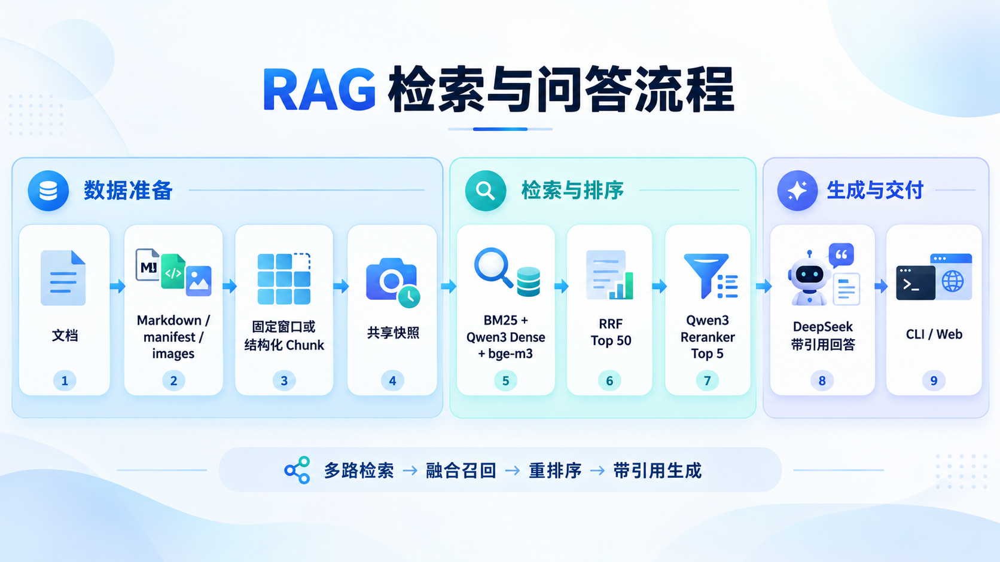
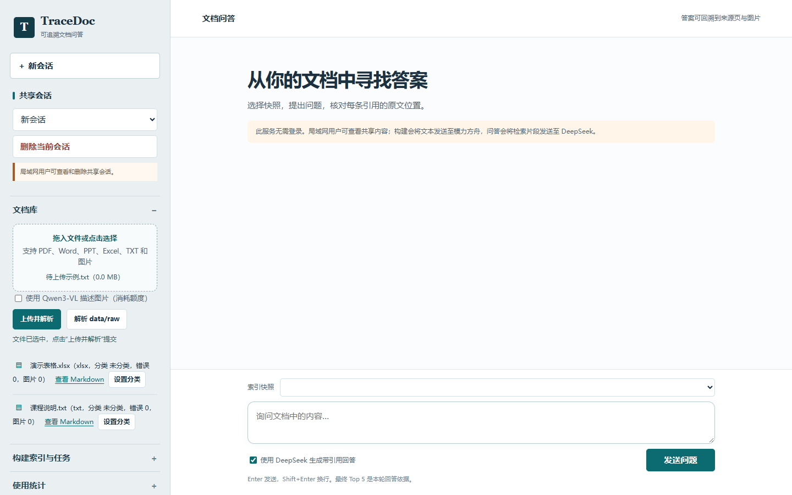
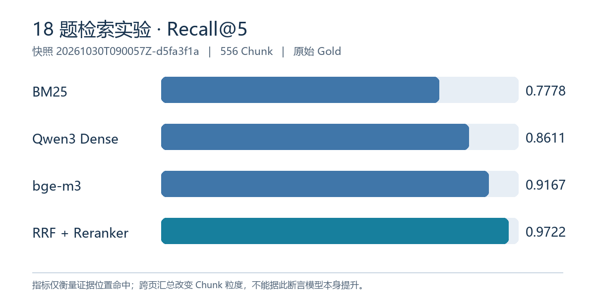
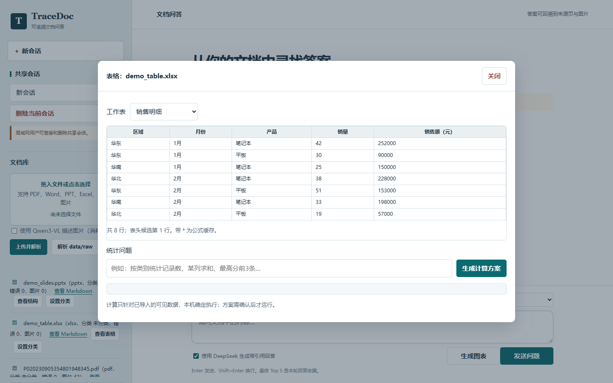
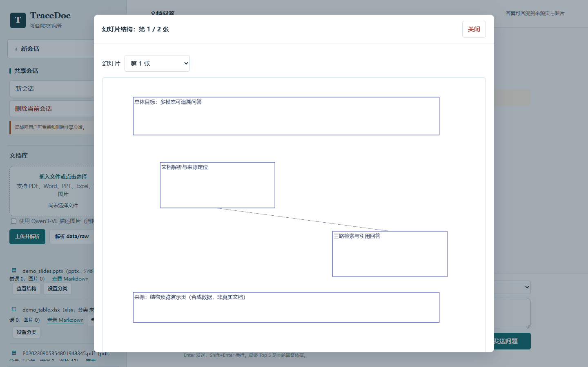
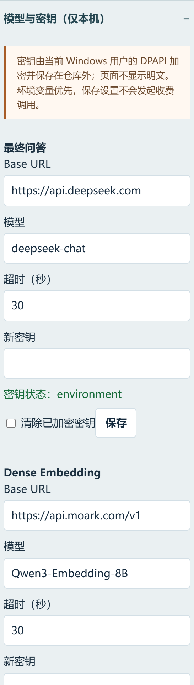
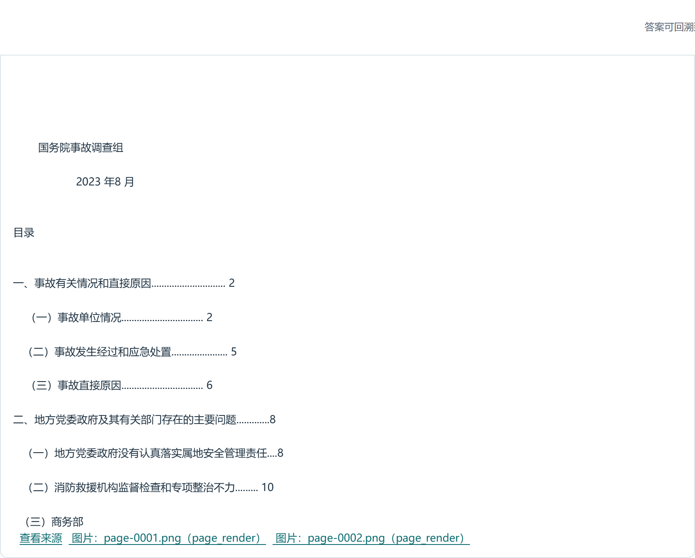
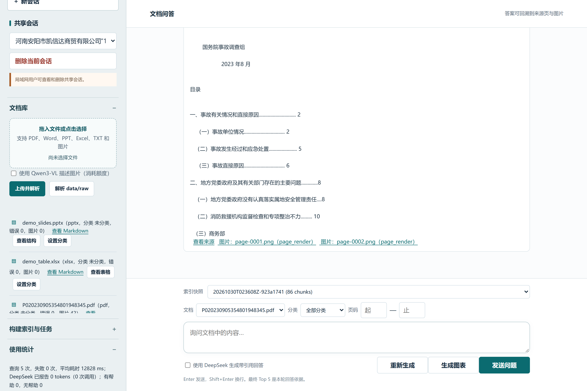
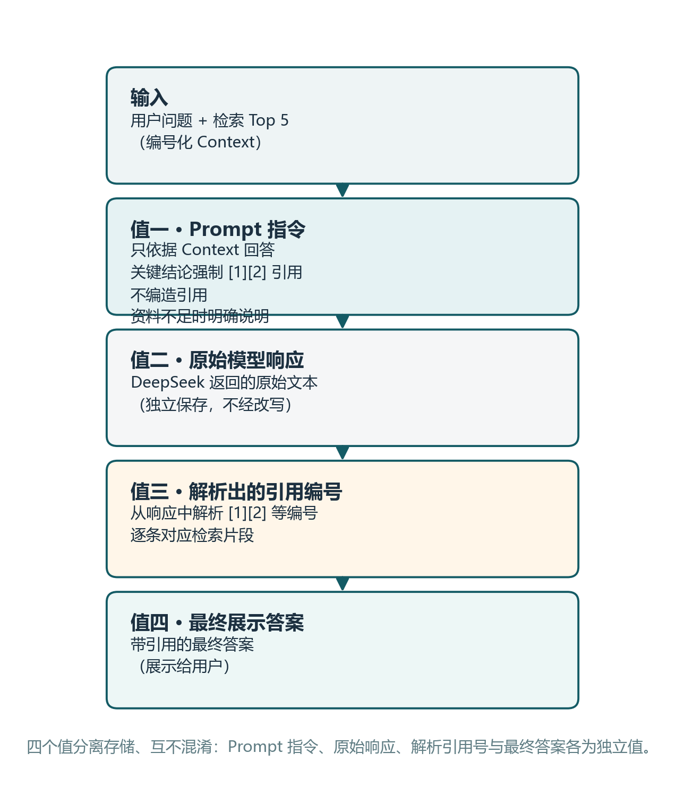

# TraceDoc RAG 项目介绍

## 1. 项目概述

TraceDoc RAG 是一个面向本地多模态文档的可追溯问答系统。系统将 PDF、DOCX、PPTX、XLSX、TXT 和图片转换为带来源定位的 Markdown，建立共享 Chunk 快照和三路检索索引，再通过 RRF 融合、Qwen3 精排与 DeepSeek 生成带引用的回答。

项目重点不是只生成答案，而是让每条答案能够回到同一个已保存快照中的 Top 5 证据，并保留文档、页码或标题路径。资料不足、证据冲突或图片描述未经人工复核时，系统会明确提示限制。

### 1.1 主要目标

- 支持常见文档和图片的批量解析，单文件失败不终止整批任务。
- 保留 PDF 页码、PPTX 幻灯片号、DOCX 标题路径等来源信息。
- 让 BM25、Dense 和 bge-m3 三路索引共享同一份 Chunk 快照。
- 使用排名融合而不是直接相加不同检索器的原始分数。
- 只把最终 Top 5 作为 DeepSeek 回答的证据，并输出可核查引用。
- 同时提供 CLI 和可信局域网 Web 界面。
- 通过 Recall@5、MRR、候选覆盖和逐题排序误差分析真实呈现质量。

## 2. 系统架构

### 2.1 总体架构

角色边界如下：

| 能力 | 模型或组件 | 用途 |
| --- | --- | --- |
| Dense Embedding | MoArk Qwen3-Embedding-8B | Build 与 Query 使用相同模型 |
| 关键词检索 | jieba + rank-bm25 | 中文分词和精确词匹配 |
| 语义补充检索 | 本地 BAAI/bge-m3 | 与 Qwen3 Dense 形成互补 |
| 精排 | MoArk Qwen3-Reranker-8B | 对 RRF 候选进行交叉编码排序 |
| 图片描述 | MoArk Qwen3-VL | 可选；描述绑定真实资产和来源页 |
| 最终回答 | DeepSeek deepseek-chat | 仅根据最终 Top 5 生成带引用回答 |

DeepSeek 不用于 Embedding；切换 Embedding 模型时必须重新 Build，不能修改旧快照元数据冒充新模型。

### 2.2 分层与数据流

- 分层清晰：src/parser（解析）、src/chunker（切块）、src/index（建库与视觉索引）、src/retrieval（检索与融合）、src/qa（回答、图表、表格计算）、src/evaluation（评测与复核）、src/service（Web 与会话）、src/utils（模型与设置）八层，各组件职责单一、界限分明。
- 数据流与扩展：Build 与 Query 共享同一份 Chunk 快照与元数据，切块、检索、精排、回答彼此分离，便于替换模型或新增格式/索引，具备良好的可扩展性与可维护性。
- 可维护保障：模型信息、Chunk 校验和与快照状态写入元数据；切换模型必须重建快照，不能改写旧快照元数据冒充新模型。

### 2.3 共享快照与三路索引

系统从 data/parsed/ 读取第一阶段产物，不在 Build 时重新解析 data/raw/。

支持两种切块策略：

1. 固定窗口：400 字符，50 字符 overlap。
2. 结构化切块：优先按 Markdown 标题层级切分，超长章节再执行固定窗口切分。

每个 Chunk 分开保存机器标识 chunk_id 和展示名称 display_name，并携带 doc_id、文本、页码范围和 heading_path。每次 Build 生成唯一 snapshot_id；三路索引共用同一份 chunks.jsonl。Embedding 失败的 Chunk 会被跳过并写入错误日志，不会用全零向量污染索引。

## 3. 核心功能

### 3.1 多格式解析与图片证据

- PDF：使用 PyMuPDF 逐页提取文本、嵌入图片和可选整页渲染，在 Markdown 中保留 `<!-- PAGE:n -->`。
- DOCX：按标题样式转换 Markdown，为段落生成定位标识，不伪造页码。
- PPTX：按幻灯片顺序提取标题、正文、备注和图片，保留 slide 编号。
- XLSX：只读工作表已保存的单元格值，Markdown 保留工作表与原始行号；不执行公式或伪造页码。单表上限 5000 行、100 列，超限写入错误记录。未缓存公式结果、图表与旧 .xls 不支持。
- TXT：检测编码，转为 Markdown，并在 manifest 中记录字符数。
- 图片：通过真实文件内容识别格式，不仅依赖扩展名；可执行本地 OCR。

每个文档产出独立目录：

| data/parsed/{doc_id}/ | document.md | images/ | manifest.json | errors.jsonl |
| --- | --- | --- | --- | --- |

视觉模型生成的图片描述会绑定实际图片资产以及可用的页码或幻灯片号，并标注模型和 unreviewed 状态。视觉描述是辅助语义，不等同于经过人工确认的原文；没有实际图片资产时不能生成或引用图片结论。

### 3.2 数据集与试点范围

评测数据采用公开的 MMLongBench-Doc。其项目说明列出 135 份 PDF 文档、1091 道问答题，覆盖文本、表格、图表和图片等证据类型，也包含跨页题与无法回答的题目。每条题目带有问题、参考答案、证据页和证据类型等字段。数据集来源：MMLongBench-Doc 官方项目（https://github.com/mayubo2333/MMLongBench-Doc）。

本项目没有把完整数据集的 1091 题当成已评测结果。为控制模型调用成本，从本地 D:/RAG/MMLongBench-Doc 中按文件名确定性选取前 5 份 PDF，形成 29 道有证据页的扩展试点题；另有 11 道无证据页题单独保存，不计入检索 Recall@5 与 MRR。试点题覆盖文字、图表、图片和跨页统计问题。先前三文档、18 题的视觉增强实验仍独立保留，两组语料和解析方式不同，指标不作直接横向比较。

导入器保留原始 evidence_pages 标签并生成独立 Gold；解析器与最终引用使用从 1 开始的 PDF 物理页。两种编号需要逐题核对，不能统一偏移。各快照的正式指标在第 4 节呈现，人工复核另存派生文件；原始数据和 Gold 不会被复核结果覆盖。

### 3.3 混合检索与引用问答

Query 严格加载一个完整、已保存的 Build 快照，不重新解析文档、不重新切块，也不创建另一套 Chunk。

检索流程为：

| 用户问题 | -> BM25 Top 20 | -> Qwen3 Dense Top 20 | -> bge-m3 Top 20 | -> RRF(k=60) Top 50 | -> Qwen3 Reranker | -> 最终 Top 5 | -> DeepSeek 回答与引用 |
| --- | --- | --- | --- | --- | --- | --- | --- |

RRF 公式为：

| score(d) = sum(1 / (60 + rank_i(d))) |
| --- |

BM25、Dense 和 bge-m3 的原始分数尺度不同，因此项目禁止直接把三路原始分数相加。

检索还可以在融合前按文档、共享分类或页码范围收窄候选片段：文档按 doc_id 过滤，分类映射到对应文档，页码范围按区间重叠匹配，页码范围缺失的幻灯片或无页文本不参与页码过滤。命中过滤时召回量会自动放宽，确保最终 Top 5 仍有足够证据。返回的每条结果都携带 doc_id、页码或幻灯片号、heading_path 和分数，可进一步打开来源 Markdown、同页图片或结构预览核对原文。

DeepSeek 收到编号化 Context，并被要求：

1. 只依据 Context 回答；
2. 关键结论使用 [1][2] 等编号引用；
3. 不编造引用；
4. 资料不足时明确说明。

Prompt、原始模型响应、解析出的引用编号和最终展示答案在程序中保持为不同值。API 失败时，系统仍保留并输出检索 Top 5。

### 3.4 CLI 与 Web 产品

#### CLI

| python app.py parse | python app.py build | python app.py query "用户问题" | python app.py test GOLD.jsonl --snapshot-id SNAPSHOT_ID | python app.py serve |
| --- | --- | --- | --- | --- |

CLI 是项目主入口；增加 Web 后仍保持 parse、build、query 和 test 可用。query 命令可通过 `--doc-id`（可重复）、`--page-start`、`--page-end` 限定检索范围。

#### 局域网 Web

Web 界面采用对话主栏与文档侧栏，面向可信局域网多人共享。文件可拖入侧栏或点击选择，选中后需点击“上传并解析”才会提交。界面可完成上传与解析、共享文档分类、Build 真实逐块进度、选择快照、提问、查看 Top 5 与同页图片、查看回答与引用、多轮会话以及后台任务状态。失败、部分成功或服务重启后中断的安全任务可以重试，页面可以查看结构化错误摘要。匿名统计只记录请求次数、失败、耗时和 DeepSeek 实际返回的 Token 用量；逐题好评或差评只保存关联 ID 和评分。

模型和密钥管理只允许从服务所在电脑访问。真实 API Key 不进入代码、Git、快照、报告或请求日志；Windows 环境下使用当前用户 DPAPI 保存。服务不记录问题正文、原始 Prompt、原始模型响应或 Chunk 文本到请求事件日志。

局域网模式当前无登录，因此同网段可访问者能够看到共享文档和会话。该模式不能直接暴露到互联网，也不适合存放私人资料。

#### Web 模块与作用

工作台按文档入库、构建和提问的使用顺序组织。以下功能均对应当前页面的实际入口：

**文档库：** 上传文件并解析，或解析 data/raw 中已有文件；列表显示格式、分类、错误数和图片数。可设置共享分类，并打开解析后的 Markdown 核对内容和位置。

**图片描述：** 上传或批量解析前可勾选 Qwen3-VL。描述与原图片资产及页码或幻灯片绑定；需要模力方舟额度，未经人工核验的模型描述不能当作已确认的原文。

**构建索引：** 选择按标题切块或固定窗口后启动后台 Build。系统从解析产物创建一个保存的快照，三路索引共用同一批 Chunk；构建会使用模力方舟模型额度。

**任务状态：** 显示解析和构建的真实阶段、已完成数量及错误数。可以查看结构化错误；失败、部分成功或中断的任务可按原参数重试。

**向文档提问：** 选择完整索引快照后输入问题；可勾选 DeepSeek 生成回答，也可只看检索结果。提问前可按文档、分类或页码范围缩小范围，每轮从所选快照检索最终 Top 5，并以这些片段作为本轮回答依据。

**证据与来源：** 回答下方列出 Top 5 的来源、页码或章节、分数和文本；可打开来源 Markdown 与关联图片。引用编号对应本轮检索片段，便于核对结论。

**共享会话：** 新建、恢复、切换或删除多轮问答。历史记录帮助理解追问，但历史回答不作为证据；无登录的局域网用户都能查看和删除共享会话。

**反馈与统计：** 每轮可标记“有帮助”或“无帮助”；页面汇总查询次数、失败次数、平均耗时、已报告的 DeepSeek Token 用量和反馈数量。Token 统计仅覆盖 API 返回用量的调用。

**模型与密钥：** 该区域仅服务所在电脑可访问，可查看模型角色与密钥状态并设置地址、超时和新密钥。Windows 密钥使用当前用户 DPAPI 加密并保存在仓库外，页面不返回明文。

## 4. 系统可用性

### 4.1 测试与容错

- 充分测试：tests/ 下 30 个测试文件、107 项测试用例全量通过（unittest），覆盖解析、切块、三路检索、融合精排、元数据过滤、问答、评测、Web、表格计算、图表与视觉索引等模块。
- 稳定与容错：单文件解析失败不终止整批任务；Embedding 失败的 Chunk 跳过并写错误日志、不用全零向量污染索引；失败或中断的后台任务可按原参数重试并查看结构化错误。

### 4.2 实测评测

评测采用公开的 MMLongBench-Doc 数据集，分两组进行：三文档 18 题的多模态增强实验，以及五文档 29 题的扩展试点。评测保留数据集原始 evidence_pages 标签，不统一偏移页码；系统引用使用从 1 开始的 PDF 物理页，两种编号需逐题核对。各实验分别记录 BM25、Qwen3 Dense、bge-m3 与融合精排的 Recall@5 和 MRR，不混用快照或 Gold。

| 实验（Chunk 证据粒度） | BM25 Recall@5 | Dense Recall@5 | bge-m3 Recall@5 | 融合 Recall@5 | 融合 MRR |
| --- | --- | --- | --- | --- | --- |
| 18 题·原始证据页（415 Chunk） | 0.6111 | 0.7222 | 0.6778 | 0.6944 | 0.6713 |
| 18 题·全页视觉描述（539 Chunk） | 0.6778 | 0.8333 | 0.8167 | 0.8444 | 0.8472 |
| 18 题·跨页照片汇总（556 Chunk） | 0.7778 | 0.8611 | 0.9167 | 0.9722 | 0.9028 |
| 29 题·统一解析（941 Chunk） | 0.6172 | 0.6379 | 0.6379 | 0.6379 | 0.5920 |

三组 18 题实验的指标随证据粒度递进：原始证据页、全页视觉描述、再到跨页照片汇总。跨页照片汇总把多页照片聚合为一个 Chunk，改变了证据粒度，其分数不能与逐页 Chunk 直接比较。29 题为文本与本地解析信息的检索对照，未生成视觉描述资产、也未逐题调用 DeepSeek 生成答案，不能与 18 题视觉增强分数直接比较。上表均为标注证据页的检索指标（Recall@5/MRR），不等于最终答案正确率；视觉描述与照片人数仍标记为未经人工核验，原始 Gold 与人工复核均另存派生文件、不覆盖原标注。

### 4.3 安全与可复现性

- .env、API Key、DPAPI 密钥文件、原始文档、会话数据库、模型缓存和大型索引不提交 Git。
- .env.example 只包含占位符。
- Build 与 Query 的模型信息、Chunk 校验和和快照状态保存在元数据中。
- 原始 Gold 不覆盖；人工复核生成派生文件和审计报告。
- 文档、OCR 文本和历史回答都视为数据，不视为指令。
- Query 只引用当前轮最终 Top 5；历史回答不能成为证据。

### 4.4 已知限制

1. 检索质量与答案证据是两项不同检查。早期 18 题报告中融合精排 Recall@5 为 0.6944，低于 Dense 的 0.7222；该历史报告保留。全页视觉描述快照的原始标签融合 Recall@5 为 0.8444。加入跨页照片汇总后的新快照达到 0.9722，但 Chunk 证据粒度已改变，不能解释为相同条件下模型本身提升。图表列值与照片人数仍需按原图核对，照片人数由视觉模型估计，拥挤照片不能宣称精确人数。
2. 扫描页 OCR 只提供待核验文本。可选的本地整页 OCR 在真实图片型页面试验中提取了 152 个字符，但标题词间距及小字仍有误识。原图、OCR 块和来源页一同保留，OCR 标记为 unreviewed；涉及日期、人名或数字时须回看原图，无法确认就回答资料不足。改进后的解析文本需要新建索引快照，不能改写旧快照。
3. 图表与照片视觉描述尚未逐项人工核验。Qwen3-VL 描述绑定真实图片和页码，但图例、单位、数字、人数和图形关系可能误读，保留 unreviewed 标记。个别页面的徽标误识别已留人工修正记录；其他页的照片人数仍需抽查。演示中应展示原图和描述的对应关系；只有核对过的具体结论才能用于确定性回答。
4. MoArk 额度有限；无额度时展示已保存的真实 18 题报告，不伪造现场调用。
5. PPTX 已用真实 7 页文件验证 43 个图片资产和幻灯片定位；旧 .ppt 不支持。
6. Web 无登录，仅适合可信局域网；所有用户共享文档和会话。
7. Build 页面显示真实阶段和错误数，尚无逐块进度百分比。
8. 模型服务、网络和本地 bge-m3 权重是完整运行的外部依赖。

## 5. 课题外附加亮点

本项目除文档解析、建库和检索问答外，还将原型扩展为可在可信局域网使用的产品。以下能力已在代码中实现；它们是可展示的附加工作，不代表课程评分必然获得满分。

局域网 Web 与交互：对话主栏和文档侧栏支持拖拽选文件、显式上传解析、文档分类、后台 Build 状态、快照选择、共享多轮会话和引用来源查看。图 1 展示实际页面；答辩时可按“上传—构建—提问—打开来源”演示。

结构化数据与图表：XLSX/CSV 解析为单元格级快照（不执行公式），可在页面按工作表浏览原始行号与单元格值（图 3），并支持受限的表格计算（计数、分类汇总、求和、均值、最值、排序与去重），计算在本机从已保存快照确定性执行，模型只提出声明式计划、看不到行数据。PPTX 按幻灯片重建原生形状与显式连接端点，生成结构预览与 Mermaid 图（图 4），箭头方向不推断。问答还可依据引用证据生成经结构校验的流程图。

模型配置与密钥保护：模型设置页只允许服务所在电脑访问；Windows 使用当前用户 DPAPI 在仓库外保存密钥，页面只显示配置状态。DeepSeek 负责最终回答，模力方舟 Qwen3 负责嵌入与精排，旧快照不会被静默换模型。

证据追溯与审计：三路索引共享保存的 Chunk 快照，回答仅引用本轮最终 Top 5；结果可返回原文页、标题或图片资产。失败任务可查看结构化错误并重试，人工复核 Gold 另存派生文件，不覆盖原标注。

视觉增强与产品反馈：图片描述和 OCR 保留原图、位置、模型及未核验状态；跨页照片实验保存证据页与人工修正记录。Web 另记录匿名请求耗时、DeepSeek 返回的 Token 用量和逐题好评／差评。视觉推断尚未全部人工核验，不能把人数估计或页码命中直接称为答案正确。

精细化 Prompt 工程：编号化 Context、只依据上下文回答、关键结论强制 [1][2] 引用、禁止编造引用、资料不足明确说明；Prompt、原始响应、解析出的引用号与最终答案四者分离存储。

## 6. 演示、运行与交付

### 6.1 演示脚本

#### 有模型额度

1. 用 python app.py serve 启动 Web，并说明默认只绑定本机。
2. 展示已解析文档、图片资产和 manifest 中的来源定位。
3. 选择一个完整 snapshot，说明三路索引共享同一 Chunk 集合。
4. 输入问题，展示三路召回、RRF、精排后的 Top 5。
5. 展示 DeepSeek 回答和 [1][2] 引用。
6. 打开引用来源，核对页码、标题路径或图片资产。
7. 展示原始标签的最新评测表，并说明跨页汇总 Chunk 改变了证据粒度，照片人数仍有待人工核验。

#### 无模型额度

1. 启动 Web，展示文档、快照、历史任务和已保存会话。
2. 使用已有的脱敏 Query、回答和引用截图说明完整流程。
3. 打开保存的正式评测、候选分析和 Gold 复核报告。
4. 说明现场未发起 MoArk 调用是为了避免把额度错误伪装成系统失败。
5. 运行不消耗模型额度的单元测试或 compileall 作为现场验证。

### 6.2 环境与运行

环境要求：Windows、Python 3.10+；完整 Build/Query 还需要 MoArk 额度、本地 bge-m3 权重和 DeepSeek API Key。

| cd D:\RAG | python -m venv .venv | .venv\Scripts\Activate.ps1 | pip install -r requirements.txt | Copy-Item .env.example .env | # 在 .env 中填写自己的密钥，不要提交该文件 | python app.py --help | python app.py serve |
| --- | --- | --- | --- | --- | --- | --- | --- |

### 6.3 提交物

- 源码：release/TraceDocRAG-source-20261031.zip 是当前工作目录快照，含照片清单、跨页汇总与 XLSX 解析；其 SOURCE_STATE.txt 标明基准 Git 提交与尚未提交的改动。GitHub https://github.com/a4l111/tracedoc-rag 仍为较早版本。当前工作目录 107 项单元测试全部通过（unittest 实测）。
- 可执行入口：release/TraceDocRAG-Windows-20261031.zip 是同一工作目录重建的 Windows onedir Web 发行包，TraceDocRAG.exe --help 已通过；本机 Web 上传合成 XLSX 后后台解析完成、错误 0。完整模型问答仍需另配权重和 API Key。start_web.bat 是依赖 Python 环境的备用入口。
- 介绍材料：本 Word 文件为提交版候选，已加入隔离演示 Web 截图、真实评测图及结构化数据、幻灯片结构预览截图。
- 评测附件：脱敏后的正式报告、候选分析、人工复核报告和必要截图。

源码包和可执行包基于同一工作目录版本；改动尚未提交到 GitHub。大型模型、原始文档、历史会话和真实密钥不进入提交包；完整 Build 和问答需另行配置模型资源及 API Key。
